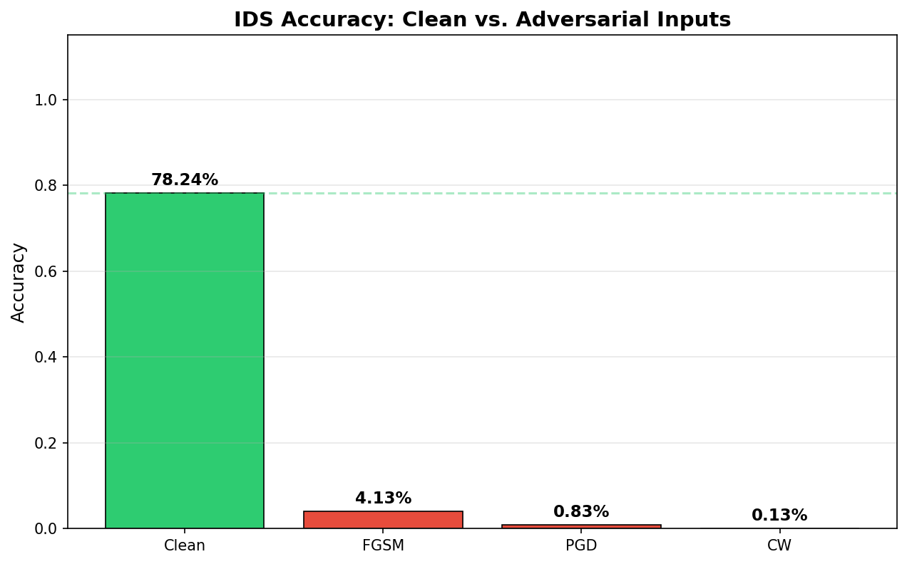

# Adversarial Attacks on AI-Based Intrusion Detection

This module trains a neural network intrusion detector on NSL-KDD, then attacks it with three adversarial methods to see how much accuracy survives.

## Attack methods

| Attack | Paper | Description |
|--------|-------|-------------|
| FGSM | Goodfellow et al., 2014 | Single-step gradient sign perturbation. Fast, weaker. |
| PGD | Madry et al., 2017 | Iterative projected gradient descent. Stronger white-box attack. |
| C&W | Carlini & Wagner, 2017 | Optimization-based L2 attack that searches for minimal perturbations. |

## Project structure

```
adversarial_ids/
├── main.py                  # Full pipeline: train, attack, evaluate
├── data/loader.py           # NSL-KDD download and preprocessing
├── models/ids_model.py      # PyTorch MLP classifier and trainer
├── attacks/adversarial.py   # FGSM, PGD, C&W implementations
├── utils/evaluation.py      # Metrics, confusion matrices, charts
└── results/                 # Generated plots and saved model
```

## Setup

```bash
cd adversarial_ids
pip install -r requirements.txt
```

## Usage

```bash
# Full pipeline (binary classification, epsilon 0.1)
python main.py

# Custom parameters
python main.py --epochs 50 --epsilon 0.2 --attack-samples 10000

# Multi-class: normal / dos / probe / r2l / u2r
python main.py --no-binary
```

## Output

Each run writes these files to `results/`:

- `training_history.png`: loss and accuracy curves
- `accuracy_comparison.png`: clean vs. adversarial accuracy
- `confusion_matrices.png`: side-by-side confusion matrices
- `perturbation_analysis.png`: the most perturbed features per attack
- `ids_model.pt`: saved model weights (not tracked in git)

## Dataset

NSL-KDD is the cleaned-up successor to the KDD Cup 1999 intrusion dataset. It has 125,973 training records and 22,544 test records with 41 features each. The loader downloads it on first run.

## Results

Default run (binary, epsilon 0.1, 5,000 attacked samples):

| Input | Accuracy |
|-------|----------|
| Clean test set | 78.24% |
| FGSM | 4.13% |
| PGD | 0.83% |
| C&W | 0.13% |

The clean score is modest, which is typical for NSL-KDD: the test split contains attack types that never appear in training. The adversarial numbers are the point. A small perturbation inside the epsilon ball is enough to push a trained detector below chance, and the iterative attacks finish the job that FGSM starts.



Your numbers will shift with the seed, epoch count and epsilon.

## References

- Goodfellow, Shlens & Szegedy (2014). *Explaining and Harnessing Adversarial Examples.* arXiv:1412.6572
- Madry et al. (2017). *Towards Deep Learning Models Resistant to Adversarial Attacks.* arXiv:1706.06083
- Carlini & Wagner (2017). *Towards Evaluating the Robustness of Neural Networks.* IEEE S&P
- Tavallaee et al. (2009). *A Detailed Analysis of the KDD CUP 99 Data Set.* IEEE CISDA
