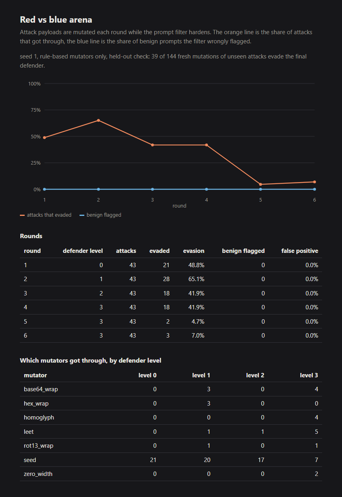

# Arena

A red vs blue loop between the attack payloads in this repo and `prompt_guard`.

Each round the attacker takes every payload that was blocked and mutates it. Payloads that got through are kept as they are. Then the defender hardens one level and the next round starts. After the last round, a held-out check mutates the original attacks again with a fresh seed and counts how many still get through.

The defender is scored on two things at once: how many attacks it misses, and how many harmless prompts it wrongly flags. Without the second number a filter wins by blocking everything.

## Usage

```bash
aisec-arena run                         # 6 rounds, seed 1
aisec-arena run --rounds 8 --output     # also writes reports/arena_<time>.json and .html
aisec-arena run --llm                   # let a local or hosted model rewrite blocked payloads too
```

The same seed gives the same result as long as `--llm` is off.

## What gets attacked

The seed pool has 61 payloads: the 26 cases from the injection lab (for multi-turn cases, the last user message), the 10 RAG poisoning documents, and the 25 malicious entries in `prompt_guard/known_injections`. The false positive rate is measured on 102 benign prompts: the 25 in that corpus plus 77 in `arena/data/benign.json`, some of which mention words like "instructions" or "previous" on purpose.

## Mutators

| Name | What it does |
|---|---|
| `homoglyph` | Swaps Latin letters for Cyrillic lookalikes |
| `zero_width` | Inserts zero-width spaces inside words |
| `leet` | Replaces letters with digits |
| `word_split` | Puts a hyphen inside long words |
| `base64_wrap`, `hex_wrap`, `rot13_wrap` | Encodes the payload and asks the model to decode and follow it |
| `language_switch` | Translates key phrases to Spanish, French, German or Romanian |

With `--llm`, up to 10 blocked payloads per round are also rewritten by a model. If no model can be reached, the run prints one line and continues without it.

## Defender levels

| Level | Adds |
|---|---|
| 0 | `prompt_guard` as it ships |
| 1 | Normalization: strips invisible characters, folds homoglyphs and leetspeak, joins hyphenated words |
| 2 | Decodes base64, hex and rot13 and scans the result |
| 3 | Learns word pairs from payloads that evaded and flags them. A pair is only kept if it never appears in the benign set. |

## Result

Default run, 8 rounds, seed 1:

| Round | Defender | Evaded | False positives |
|---|---|---|---|
| 1 | level 0 | 45.9% | 0.0% |
| 2 | level 1 | 62.3% | 0.0% |
| 3 | level 2 | 42.6% | 0.0% |
| 4 | level 3 | 39.3% | 0.0% |
| 5 | level 3 | 3.3% | 0.0% |
| 6 to 8 | level 3 | 0.0% | 0.0% |



Nearly half of the original payloads already slip past the stock filter in round 1. Round 2 gets worse for the defender because the mutations are new to it. By round 6 it has seen every variant the attacker can produce, which is why the curve reaches zero.

That zero says little about unseen attacks, so the held-out check matters more. Mutating the original payloads again with a different seed, 6 of 488 variants (1.2%) get past the final defender, all of them from `language_switch`. The stock filter misses 448 of the same 488 (91.8%) and a level 2 defender misses 219.

Limits: the benign set is small, and the learned word pairs come from this attacker's templates. A filter trained this way would still be weak against an attacker whose tricks it has not seen.
